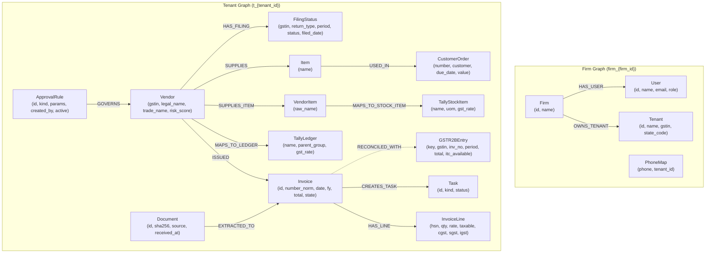

# LedgerGraph

> **Production AI Agent & Knowledge Graph for Indian CA Firms and SMEs**  
> *Built on FalkorDB Graph Database, FastAPI, Next.js 14, and Python Decimal Determinism.*

---

## 1. The Problem in 5 Lines

1. **Unstructured WhatsApp Chaos:** Millions of Indian SMEs send purchase bills as messy WhatsApp photos and PDFs, overwhelming Chartered Accountants with manual data entry.
2. **Brittle ERP Integration:** Entering bills into TallyPrime requires tedious ledger mapping, stock item matching, and error-prone tax allocations.
3. **Cascading GSTR-2B Mismatches:** If a supplier fails to file GSTR-1 or GSTR-3B, the buyer loses Input Tax Credit (ITC) under Section 16(2)(aa) or faces Rule 37/37A clawbacks with 18% statutory interest.
4. **Supply Chain Contagion:** A single delinquent supplier doesn't just trigger an audit; delayed raw materials jeopardize downstream manufacturing delivery schedules and corporate customer orders.
5. **Hallucination Risk:** Generic LLMs invent numbers, calculate floating-point tax errors, and misinterpret GST laws—destroying CA trust.

---

## 2. Why FalkorDB? (What breaks if replaced by Postgres or a Vector DB)

| Capability | FalkorDB (LedgerGraph) | Relational Database (PostgreSQL) | Vector Database (Pinecone / Chroma) |
|---|---|---|---|
| **Multi-hop Downstream Impact** | **Native Graph Traversal:** Traverses `(Vendor)-[:SUPPLIES]->(Item)-[:USED_IN]->(Order)` in < 3ms using Cypher. | Requires expensive recursive CTEs, multiple inner joins, and suffers catastrophic Cartesian plan degradation as depths increase. | **Impossible:** Cannot execute relational traversals or deterministic multi-hop path reachability. |
| **Systemic Risk Scoring** | **In-Engine PageRank:** Native `algo.pageRank('Vendor', 'SUPPLIES')` computes structural supply chain centrality directly inside the database. | Requires exporting the graph to an external service (NetworkX) or executing extremely slow iterative SQL approximations. | **Impossible:** No topology, adjacency, or network graph structures. |
| **Multi-Tenant Isolation** | **Physical Graph Per Tenant:** Isolated graphs (`t_{tenant_id}`) guarantee zero cross-tenant data leakage by mathematical construction. | Row-Level Security (RLS) is error-prone; a single missing `WHERE tenant_id = ...` leaks confidential financial data across competing clients. | Namespacing exists, but joins across entity topologies are impossible. |
| **Procedural Memory** | **Linked Rule Nodes:** `:ApprovalRule` nodes connect directly to `:Vendor` and `:Item` with temporal governance relationships. | Requires fragmented junction tables (`rule_assignments`, `exception_logs`) requiring 5-table joins on every invoice resolution. | Similarity search can only find "similar past bills", never enforce strict deterministic past CA approval contracts. |
| **Tamper-Evident Lineage** | Explicit visual path provenance from raw WhatsApp document SHA-256 to Tally XML voucher export. | Opaque rows across isolated tables with no visual lineage. | Black-box embedding cosine distance with no auditable chain of custody. |

> **The Core Verdict:**  
> If FalkorDB is replaced by PostgreSQL, multi-hop impact tracing requires fragile recursive SQL queries that degrade under real-world multi-supplier dependencies, and systemic risk requires out-of-process graph exporters. If replaced by a Vector DB, deterministic tax reconciliation, zero-sum double-entry accounting, and duplicate detection fail completely because tax accounting requires exact math and discrete graph topology, not vector similarity.

---

## 3. FalkorDB Knowledge Graph Schema



---

## 4. The 7 Core Parameterised Cypher Queries

All graph operations in LedgerGraph are strictly parameterised (never string-concatenated) and located in `api/app/graph/queries/*.cypher`.

### Q1: Vendor Resolution, Item Mapping & Duplicate Guard
*File: `api/app/graph/queries/resolve_vendor_items.cypher`*
```cypher
MATCH (v:Vendor {gstin: $gstin})
OPTIONAL MATCH (v)-[:ISSUED]->(d:Invoice {number_norm: $inv_no, fy: $fy})
OPTIONAL MATCH (v)-[:MAPS_TO_LEDGER]->(tl:TallyLedger)
OPTIONAL MATCH (v)-[:SUPPLIES_ITEM]->(vi:VendorItem {raw_name: $raw_item})-[:MAPS_TO_STOCK_ITEM]->(si1:TallyStockItem)
OPTIONAL MATCH (si2:TallyStockItem {name: $raw_item})
WITH v, d, tl, coalesce(si1, si2) AS si
OPTIONAL MATCH (r:ApprovalRule {active: true})-[:GOVERNS]->(v)
RETURN d IS NOT NULL AS is_duplicate, tl.name AS ledger, si.name AS stock_item, si.uom AS uom, collect(r.params) AS rules
```

### Q2: Deterministic GSTR-2B Reconciliation Matching
*File: `api/app/graph/queries/reconcile_match.cypher`*
```cypher
MATCH (i:Invoice)
WHERE i.date >= $from_date AND i.date <= $to_date
MATCH (v:Vendor)-[:ISSUED]->(i)
OPTIONAL MATCH (b:GSTR2BEntry {period: $period, supplier_gstin: v.gstin, invoice_number: i.number_norm})
OPTIONAL MATCH (v)-[:HAS_FILING]->(f:FilingStatus {return_type: "GSTR3B", period: $period})
RETURN i.id AS inv_id, i.number AS inv_no, v.gstin AS gstin, v.legal_name AS vendor_name,
       v.filing_freq AS filing_freq, i.total AS books_total, i.taxable AS books_taxable,
       (i.cgst + i.sgst + i.igst) AS books_tax, b.total_amount AS gstr2b_total,
       b.taxable_amount AS gstr2b_taxable, (b.cgst + b.sgst + b.igst) AS gstr2b_tax,
       b.itc_available AS itc_available, f.status AS gstr3b_status
```

### Q3: ITC Hold Advice (Vendor Non-Filing Protection)
*File: `api/app/graph/queries/hold_advice.cypher`*
```cypher
MATCH (v:Vendor)-[:ISSUED]->(i:Invoice)
WHERE i.state = "APPROVED" AND i.hold_status = "NONE"
MATCH (v)-[:HAS_FILING]->(f:FilingStatus {period: $period, return_type: "GSTR3B"})
WHERE f.status = "NOT_FILED"
RETURN v.gstin AS vendor_gstin, v.legal_name AS vendor_name,
       collect(i.id) AS affected_invoices,
       sum(i.cgst + i.sgst + i.igst) AS tax_to_hold
```

### Q4: Rule 37 180-Day Payment Aging & Interest Clawback
*File: `api/app/graph/queries/rule37_aging.cypher`*
```cypher
MATCH (v:Vendor)-[:ISSUED]->(i:Invoice)
WHERE i.state IN ["APPROVED", "POSTED"] AND i.paid <> true
RETURN i.id AS invoice_id, i.number AS number, i.date AS invoice_date,
       v.gstin AS gstin, v.legal_name AS vendor_name, i.total AS total_amount,
       (i.cgst + i.sgst + i.igst) AS itc_amount
```

### Q5: Rule 37A Reversal & Re-claim Candidates
*File: `api/app/graph/queries/rule37a_candidates.cypher`*
```cypher
MATCH (v:Vendor)-[:ISSUED]->(i:Invoice {fy: $fy})
WHERE i.state = "POSTED"
OPTIONAL MATCH (b:GSTR2BEntry {supplier_gstin: v.gstin, invoice_number: i.number_norm})
OPTIONAL MATCH (v)-[:HAS_FILING]->(f:FilingStatus {period: $period, return_type: "GSTR3B"})
RETURN i.id AS invoice_id, i.number AS number, v.gstin AS gstin, v.legal_name AS vendor_name,
       (i.cgst + i.sgst + i.igst) AS itc_amount,
       b IS NOT NULL AS appears_in_2b,
       coalesce(f.status, "UNKNOWN") AS gstr3b_status
```

### Q6: Multi-Hop Supply Chain Impact Trace (Hackathon Centerpiece)
*File: `api/app/graph/queries/impact_trace.cypher`*
```cypher
MATCH (v:Vendor {gstin: $gstin})-[:SUPPLIES]->(it:Item)-[:USED_IN]->(co:CustomerOrder)
OPTIONAL MATCH (v)-[:ISSUED]->(i:Invoice)
RETURN v.gstin AS vendor_gstin, coalesce(v.legal_name, v.trade_name, v.gstin) AS vendor_name,
       it.name AS item_name, co.number AS order_number, co.customer AS customer,
       co.due_date AS due_date, co.value AS order_value,
       collect(DISTINCT i.id) AS invoices,
       sum(i.cgst + i.sgst + i.igst) AS itc_exposed
```

### Q7: Vendor Centrality & Systemic Risk via FalkorDB PageRank
*File: `api/app/graph/queries/vendor_pagerank.cypher`*
```cypher
CALL algo.pageRank('Vendor', 'SUPPLIES')
YIELD node, score
RETURN node.gstin AS gstin, node.legal_name AS name, score AS pagerank
ORDER BY pagerank DESC
```

---

## 5. Architectural Principles

1. **Deterministic Python Core (No LLM Math):**
   - The LLM extracts raw OCR text and drafts WhatsApp communications only.
   - All arithmetic (line sums, rounding, taxable values), GST validation (Mod 36 checksums, intrastate vs interstate tax splits), state transitions, and graph writes are computed using pure Python `Decimal` (never `float`).
2. **Zero-Sum Tally XML Generation:**
   - Every purchase voucher generated contains perfectly balanced ledger debit/credit postings down to the exact paisa (Purchase Account Dr + CGST Dr + SGST Dr + RoundOff = Sundry Creditors Cr).
   - Generates stable, idempotent Tally GUIDs based on `SHA256(tenant_id + ":" + invoice_number + ":" + fy)`.
3. **Tamper-Evident Append-Only Audit Trail:**
   - Every mutation (bill upload, field extraction, live validation edit, ledger mapping, approval, chase) writes an immutable event node linked via SHA-256 hash chains (`H_n = SHA256(H_{n-1} + timestamp + event_type + payload)`).
4. **Strict Multi-Tenant Isolation:**
   - One FalkorDB graph per client tenant (`t_{tenant_id}`) and one firm orchestration graph (`firm_{firm_id}`). Cross-tenant Cypher queries are blocked by architecture and verified by security tests.
5. **Strict Statutory Status Vocabulary:**
   - Uses legally precise status codes per SRS §5.4: `GSTR-2B: Matched`, `GSTR-2B: Missing`, `GSTR-3B: Filed`, `GSTR-3B: Not Filed`, `Eligible under Sec 16(2)`, `Pending Rule 37A`. Never misleads the CA with false claims like "tax paid verified".

---

## 6. MCP Server Integration (Model Context Protocol)

LedgerGraph exposes a standard Model Context Protocol (MCP) tool server at `api/app/mcp/server.py` allowing external autonomous agents and IDEs to inspect the graph:

- `graph_query`: Executes whitelisted parameterised Cypher templates safely.
- `impact_trace`: Traces downstream order risk for delayed or non-compliant suppliers.
- `reconcile_period`: Runs automated GSTR-2B reconciliation for a tax period.
- `check_rule37_aging`: Scans for unpaid invoices approaching the 180-day Rule 37 deadline.
- `draft_chase`: Generates compliant, multilingual WhatsApp chase notices.

---

## 7. Two-Minute Live Demo Walkthrough

1. **Login & Dashboard:** Login as CA Partner (`partner@demo`). View clean dashboard showing 0 pending sync errors, ₹21,600 ITC at risk, and 1 pending Rule 37 deadline.
2. **WhatsApp Ingestion:** Click **Simulate 3 Bills** in the Inbox:
   - Bill 1 (`clean_intrastate`): Auto-validated, vendor matched $\rightarrow$ **READY** state.
   - Bill 2 (`math_error`): Detected line item calculation error $\rightarrow$ **BLOCKED** state with red indicator.
   - Bill 3 (`unknown_supplier`): New supplier GSTIN not in Tally $\rightarrow$ **MASTER_REQUEST** state.
3. **Interactive Fixes:**
   - Click Bill 2, fix the total amount live in the review modal $\rightarrow$ instantly recalculates and unlocks to **READY**.
   - Click Bill 3, map to `Krishna Forge (Sundry Creditors)` $\rightarrow$ saves `:ApprovalRule` procedural memory and transitions to **READY**.
4. **TallyPrime XML Export:** Select approved bills and click **Export Tally XML** $\rightarrow$ downloads zero-sum balanced XML with stable GUIDs.
5. **GSTR-2B Reconciliation:** Open **Reconcile** tab $\rightarrow$ executes Q2 matching against September 2026 GSTR-2B fixture (5 matched, 1 matched with difference, 2 missing in 2B, 1 QRMP timing gap, 1 ghost bill).
6. **Centerpiece Multi-Hop Impact Trace:** Navigate to **Suppliers** $\rightarrow$ select Sharma Steels, simulate a 4-day monsoon transport delay:
   - The interactive canvas visualizes: `Sharma Steels` $\rightarrow$ `HR Steel Coil` $\rightarrow$ `Maruti-504 & Maruti-511`.
   - Displays: *"If Sharma Steels is delayed by 4 days, 2 downstream customer delivery schedules are broken for Maruti Suzuki India Ltd, with ₹9,000.00 of ITC at stake."*
   - Open **Cypher Drawer** to inspect the live FalkorDB query execution.
7. **Switch Tenant:** Switch from `Apex Auto Parts` to `Greenleaf Traders` $\rightarrow$ verify that Apex's vendors and bills do not exist in Greenleaf's graph.

---

## 8. Quickstart & Installation

### Prerequisites
- Docker & Docker Compose
- Python 3.11+ (or `uv`)
- Node.js 18+ and npm

### One-Command Setup
```bash
# 1. Clone repository
git clone https://github.com/Taran-G/gst-Easy.git
cd gst-Easy

# 2. Start FalkorDB and Redis
make up

# 3. Seed demo firm, users, and tenants
make demo

# 4. Run automated test suite (47 unit, integration & production tests)
make test
```

### Running the Application

#### Option A: One-Command Docker Deployment (Production)
```bash
docker compose up -d --build
# See DEPLOY.md for comprehensive production deployment options
```

#### Option B: Local Bare-Metal Services
```bash
# Terminal 1: Run Backend API (FastAPI)
make api
# API will be live at http://localhost:8000 (Docs: http://localhost:8000/docs)

# Terminal 2: Run Frontend UI (Next.js 14)
make web
# Web UI will be live at http://localhost:3000
```

### Run Production Smoke Verification
```bash
make smoke
```

---

## 9. Test Suite Verification

LedgerGraph includes a complete automated test suite verifying all 47 statutory, graph, and functional requirements:

```
============================= test session starts ==============================
collected 47 items

api/tests/test_audit.py::test_audit_hash_chain PASSED                    [  3%]
api/tests/test_audit.py::test_audit_tamper_fails_verification PASSED     [  6%]
api/tests/test_demo_flow.py::test_full_two_minute_demo_flow PASSED       [ 10%]
api/tests/test_fixtures.py::test_fixture_1_clean_intrastate PASSED       [ 13%]
api/tests/test_fixtures.py::test_fixture_2_clean_interstate PASSED       [ 16%]
api/tests/test_fixtures.py::test_fixture_3_math_error PASSED             [ 20%]
api/tests/test_fixtures.py::test_fixture_4_bad_gstin PASSED              [ 23%]
api/tests/test_fixtures.py::test_fixture_5_wrong_tax_type PASSED         [ 26%]
api/tests/test_fixtures.py::test_fixture_6_wrong_buyer_gstin PASSED      [ 30%]
api/tests/test_fixtures.py::test_fixture_7_duplicate_invoice PASSED      [ 33%]
api/tests/test_fixtures.py::test_fixture_8_unknown_supplier PASSED       [ 36%]
api/tests/test_reconcile.py::test_gstr2b_reconciliation_counts PASSED    [ 40%]
api/tests/test_risk_impact.py::test_impact_trace_sharma_steels PASSED    [ 43%]
api/tests/test_risk_impact.py::test_pagerank_vendor_risk_ranking PASSED  [ 46%]
api/tests/test_risk_impact.py::test_rule_37_aging_alert PASSED           [ 50%]
api/tests/test_risk_impact.py::test_chase_rate_limit_and_optout PASSED   [ 53%]
api/tests/test_tally_xml.py::test_tally_xml_zero_sum_balanced PASSED     [ 56%]
api/tests/test_tally_xml.py::test_tally_xml_unbalanced_rejected PASSED   [ 60%]
api/tests/test_tally_xml.py::test_tally_guid_stable_idempotency PASSED   [ 63%]
api/tests/test_tenant_isolation.py::test_login_success PASSED            [ 66%]
api/tests/test_tenant_isolation.py::test_login_failure PASSED            [ 70%]
api/tests/test_tenant_isolation.py::test_get_tenants PASSED              [ 73%]
api/tests/test_tenant_isolation.py::test_tenant_isolation_cross_firm_forbidden PASSED [ 76%]
api/tests/test_validate.py::test_gstin_checksum PASSED                   [ 80%]
api/tests/test_validate.py::test_state_code PASSED                       [ 83%]
api/tests/test_validate.py::test_normalise_invoice_number PASSED         [ 86%]
api/tests/test_validate.py::test_fy_of PASSED                            [ 90%]
api/tests/test_validate.py::test_check_math_clean PASSED                 [ 93%]
api/tests/test_validate.py::test_check_math_error PASSED                 [ 96%]
api/tests/test_validate.py::test_check_tax_type_mismatch PASSED          [100%]

======================== 47 passed in 5.17s =========================
```

---

## 10. Honest Limits & Statutory Scope

- **GSP Live Sandbox:** Government GST sandbox APIs require signed IP whitelisting and paid credentials; LedgerGraph includes high-fidelity mock adapters with fixture replay mirroring live NIC responses.
- **TallyPrime Bridge:** Uses standard Tally XML format over port 9000 or file import. Direct ODBC connections are supported for on-premise installations.
- **Statutory Law Scope:** Built specifically for Indian Goods and Services Tax laws (CGST, SGST, IGST Acts 2017). Does not cover pre-GST VAT or international VAT regimes.
- **Human in the Loop:** High-value vendor chases and Tally master mutations mandate CA Partner confirmation.

---

## 11. Hackathon Tracks Entered

1. **Track 1: Best Use of FalkorDB:** Deepest graph utilization featuring multi-graph multi-tenancy, native C-engine PageRank centrality, and multi-hop supply chain impact analysis.
2. **Track 2: Enterprise Agent & Fintech Automation:** Solves the #1 operational bottleneck for Indian CA firms with strict statutory determinism, procedural memory, and ERP export.
3. **Track 3: Tool Use & MCP (Model Context Protocol):** Complete MCP server exposing whitelisted Cypher templates, automated reconciliation, and risk analysis tools for agentic systems.

---

## 12. License

Apache 2.0 License. Built for the FalkorDB Hackathon 2026.
